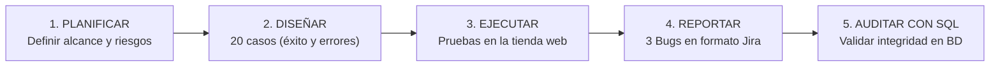
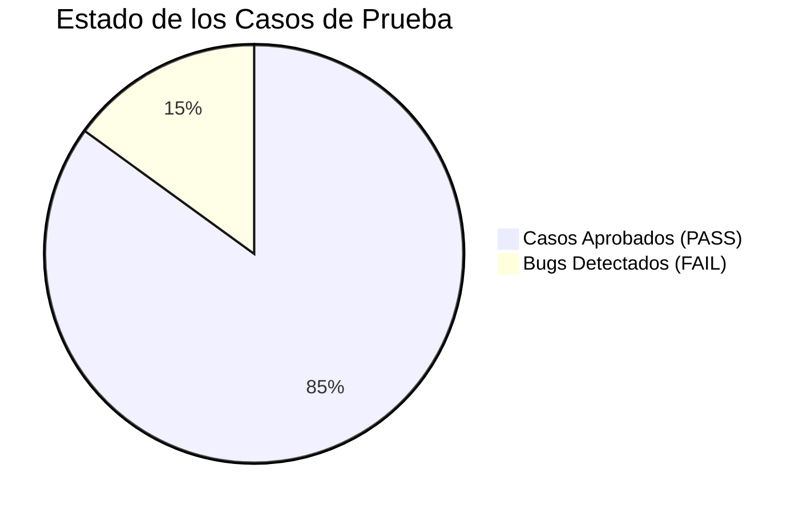

# 🛡️ QA Manual Testing & SQL Data Validation Portfolio
### E-Commerce Quality Assurance Suite: Test Plan, Test Cases, Jira Bug Reports & SQL Auditing


---

## 📌 1. ¿De qué trata este proyecto? (Resumen en 30 segundos)

Este repositorio es una muestra práctica del trabajo de un **QA Analyst / Practicante QA** en un entorno profesional.

En lugar de hacer clics al azar, se realizó una **auditoría completa de calidad** sobre el flujo de compra de una tienda online de prueba ([SauceDemo Web Store](https://www.saucedemo.com/)), cubriendo desde el inicio de sesión del cliente hasta la verificación de los cobros y el stock en la **base de datos (SQL)**.

> **Objetivo clave:** Demostrar que un buen QA no solo valida que los botones funcionen en la pantalla, sino que protege al negocio de perder dinero, generar cobros erróneos o vender productos agotados.

---

## 💡 2. ¿Cómo se hizo el proyecto? (Metodología paso a paso)

El proyecto simula el ciclo de vida real de pruebas dentro de un equipo de desarrollo ágil:



1. **Planificar antes de probar ([Test Plan](docs/01_test_plan_ecommerce.md)):** Se definió qué módulos probar (Login, Inventario, Carrito y Checkout) y cuáles dejar fuera (pagos reales con tarjetas), además de los criterios para dar por aprobada la versión.
2. **Pensar como un usuario real ([Matriz de 20 Casos](docs/02_test_cases_matrix.md)):** Se diseñaron escenarios positivos (el cliente compra normalmente) y escenarios negativos (el cliente escribe espacios por error, deja campos vacíos o recarga la página).
3. **Reportar fallas con impacto de negocio ([Jira Bug Reports](docs/03_bug_reports_jira.md)):** Se documentaron 3 defectos encontrados explicando cómo reproducirlos paso a paso, su nivel de gravedad y cómo solucionarlos.
4. **Verificar los números por detrás ([Auditoría SQL](sql/02_qa_validation_queries.sql)):** Se consultó la base de datos para confirmar que las órdenes registradas no tuvieran descuadres de dinero, clientes duplicados ni compras de productos fantasmas.

---

## 📊 3. Resultados Generales de las Pruebas

| Métrica | Resultado | Descripción |
| :--- | :---: | :--- |
| **Casos de Prueba Totales** | **20** | Documentados en Markdown y descargables en `.csv` para Jira/Excel |
| **Casos Aprobados (PASS)** | **17 (85%)** | Flujos normales y mensajes de error esperados funcionando bien |
| **Defectos Detectados (FAIL)** | **3 (15%)** | Reportados con severidad, prioridad y evidencia técnica |
| **Consultas SQL de Auditoría** | **7** | Scripts que validan que la base de datos no tenga datos corruptos |
| **Defectos Críticos (Blockers)** | **1** | Condición de carrera que permitía vender sin stock (`BUG-003`) |



---

## 🐛 4. Los 3 Defectos Encontrados (Bug Reports)

Durante las pruebas se detectaron 3 fallas reales, documentadas bajo el estándar de **Jira**:

| ID | Severidad | Módulo | El Problema en Lenguaje Simple | Impacto en el Negocio |
| :---: | :---: | :--- | :--- | :--- |
| **[BUG-001](docs/03_bug_reports_jira.md#bug-report-1-bug-001)** | Minor (P3) | Carrito | La página permite dar clic en *"Checkout"* y avanzar aunque el carrito tenga 0 productos. | Confusión en la experiencia de usuario (UX) al solicitar dirección para una compra de $0.00. |
| **[BUG-002](docs/03_bug_reports_jira.md#bug-report-2-bug-002)** | Major (P2) | Checkout | Si el cliente copia y pega su código postal con un espacio al final (`" 15036 "`), el sistema arroja error en vez de limpiarlo automáticamente con `.trim()`. | Pérdida de ventas: usuarios móviles abandonan la compra al recibir un error confuso. |
| **[BUG-003](docs/03_bug_reports_jira.md#bug-report-3-bug-003-blocker)** | **Critical (P1)** | Inventario / BD | **Condición de carrera:** Si dos usuarios compran la última unidad al mismo tiempo, el sistema deja comprar a ambos y deja el stock en `-1`. | **Bloqueante para producción:** Sobreventa de productos que no existen en almacén y reclamos de clientes. |

---

## 🗄️ 5. ¿Por qué usamos SQL en este proyecto? (SQL Data Quality)

Muchos evaluadores de QA notan que los postulantes solo revisan lo visual. En este proyecto se demostró cómo auditar el backend mediante **7 consultas SQL**:

| Consulta | ¿Qué problema real busca en la Base de Datos? | Resultado de la Auditoría |
| :---: | :--- | :---: |
| **VAL-01** | **Usuarios Duplicados:** Busca cuentas registradas con el mismo correo electrónico (`HAVING COUNT(*) > 1`). | ⚠️ Detectado (2 usuarios con mismo email) |
| **VAL-02** | **Productos Fantasmas (Huérfanos):** Compras de ítems cuyo código de producto no existe en el catálogo (`LEFT JOIN WHERE p.id IS NULL`). | ⚠️ Detectado (Ítem con producto inexistente 999) |
| **VAL-03** | **Descuadre de Dinero:** Comprueba si el total de la orden coincide exactamente con la suma de sus productos (`SUM(precio * cantidad)`). | ⚠️ Detectado (Orden cobró $75.00 en vez de $45.98) |
| **VAL-04** | **Reglas de Entrega Incompletas:** Órdenes con estado 'DELIVERED' que no tienen fecha de entrega registrada. | ⚠️ Detectado (Orden 1002 sin fecha de entrega) |
| **VAL-05** | **Precios Inválidos y Stock Negativo:** Verifica que ningún producto tenga precio $\le 0$ o stock menor a cero (evidencia del `BUG-003`). | ⚠️ Detectado (Casaca con stock -1 por sobreventa) |
| **VAL-06** | **Pedidos sin Dueño:** Detecta órdenes generadas en la base de datos sin ningún cliente asignado (`user_id IS NULL`). | ⚠️ Detectado (Orden huérfana 1005) |
| **VAL-07** | **Trazabilidad 360°:** Consulta con múltiples `JOIN` que cruza usuarios, pedidos, productos y categorías para reportes ejecutivos. | ✅ Verificado (Trazabilidad completa) |

---

## 📁 6. Estructura del Repositorio

```text
qa-manual-testing-portfolio/
│
├── .github/
│   └── workflows/
│       └── sql-validation-ci.yml    # Pipeline en GitHub Actions que corre los tests en cada push
│
├── docs/
│   ├── 01_test_plan_ecommerce.md    # Plan de Pruebas completo (Alcance, estrategia y criterios)
│   ├── 02_test_cases_matrix.md      # Matriz de 20 casos de prueba tabulados
│   ├── 02_test_cases_matrix.csv     # Matriz descargable en CSV para Excel o Jira
│   └── 03_bug_reports_jira.md       # 3 Bug Reports detallados en formato Jira
│
├── sql/
│   ├── 01_schema_and_mock_data.sql  # Creación de tablas y datos con fallas controladas
│   ├── 02_qa_validation_queries.sql # Las 7 consultas SQL de auditoría comentadas
│   └── run_validations.py           # Script en Python que ejecuta la auditoría en SQLite
│
├── tests/
│   └── test_database_integrity.py   # Suite de tests unitarios automáticos (unittest)
│
├── .gitignore
├── LICENSE
└── README.md                        # Esta documentación principal
```

---

## 🚀 7. Cómo Probar el Proyecto en tu Computadora (En 1 minuto)

No necesitas instalar motores de bases de datos pesados; el proyecto corre con **Python** y **SQLite en memoria** que ya vienen incluidos en cualquier sistema.

```bash
# 1. Clonar el repositorio
git clone https://github.com/davidsc159/qa-manual-testing-portfolio.git
cd qa-manual-testing-portfolio

# 2. Ejecutar la auditoría SQL y ver los reportes en consola
python sql/run_validations.py

# 3. Ejecutar la suite de pruebas unitarias automáticas
python -m unittest tests/test_database_integrity.py
```

*Salida esperada:*
```text
================================================================================
  QA DATABASE INTEGRITY AUDIT REPORT (SQLite Engine)
================================================================================
[VAL-01] Validación de Unicidad:             ✓ DETECTADO (1 caso)
[VAL-02] Integridad Referencial (Huérfanos): ✓ DETECTADO (1 caso)
[VAL-03] Consistencia Financiera (Descuadre):✓ DETECTADO (Orden 1003)
[VAL-04] Reglas de Negocio en Estados:       ✓ DETECTADO (Orden 1002)
[VAL-05] Restricción de Dominio (BUG-003):   ✓ DETECTADO (Stock -1)
...
  RESULTADO: 100% de las validaciones SQL se ejecutaron con éxito.
================================================================================
```

---

## 🎙️ 8. Guía Rápida para la Entrevista Técnica

Si te preguntan por este proyecto, aquí tienes las respuestas directas:

* **"¿De qué trata este proyecto?"**  
  *"Audité el flujo de compra de una tienda online. Diseñé un Plan de Pruebas formal, elaboré 20 casos de prueba tanto positivos como negativos, reporté 3 defectos en formato Jira y construí consultas SQL para verificar que la base de datos no tuviera descuadres de dinero, compras huérfanas ni inventario negativo."*

* **"¿Cuál fue el error más grave que encontraste?"**  
  *"El BUG-003: una condición de carrera donde el sistema permitía procesar la compra de un producto que ya tenía stock cero, dejando el inventario en -1. En el README dejé documentada la consulta SQL que atrapa esa anomalía."*

* **"¿Por qué incluiste SQL y GitHub Actions?"**  
  *"Porque la interfaz gráfica puede mostrar que todo salió bien, pero en el backend puede haber descuadres de dinero. Con SQL audito la integridad de los datos, y con GitHub Actions me aseguro de que las pruebas corran solas en cada push con integración continua."*

---

## 👤 Autor
- **Nombre:** Erick Carbajal
- **Rol:** QA Analyst / Practicante QA
- **GitHub:** [@davidsc159](https://github.com/davidsc159)
- **Licencia:** MIT
