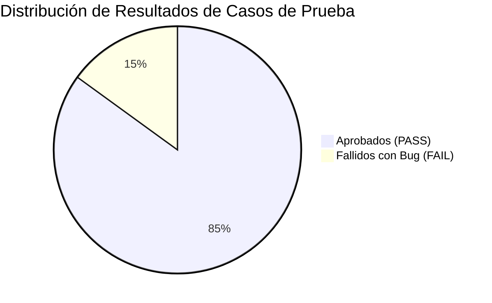

# 🛡️ QA Manual Testing & SQL Data Validation Portfolio
### E-Commerce Quality Assurance Suite: Test Plan, Test Cases, Jira Bug Reports & SQL Auditing


---

## 📌 1. Resumen Ejecutivo del Proyecto

Este repositorio constituye un **proyecto integral de Aseguramiento de Calidad (QA)** diseñado para demostrar el criterio analítico, diseño estructurado de pruebas y validación profunda de base de datos de un **QA Analyst / Practicante QA**.

El sistema bajo prueba corresponde al flujo crítico de compra de una plataforma de comercio electrónico (**SauceDemo Web Store**), abarcando desde la autenticación del cliente hasta la confirmación de la orden y la consistencia en el backend relacional.

### 🎯 Habilidades y Competencias Validadas:
- **Diseño de Pruebas de Software:** Elaboración de Plan de Pruebas formal basado en el estándar IEEE 829.
- **Técnicas de Caja Negra:** Partición de equivalencia, análisis de valores límite y pruebas exploratorias negativas.
- **Gestión Profesional de Defectos:** Redacción de Bug Reports con severidad, prioridad, pasos reproducibles y análisis de causa raíz en formato Jira.
- **SQL Testing para QA:** Consultas de auditoría para detectar duplicidad, violaciones de integridad referencial (`LEFT JOIN`), descuadres financieros y reglas de negocio.
- **Integración Continua (CI/CD):** Pipeline automatizado en GitHub Actions para verificar la integridad de la base de datos en cada commit.

---

## 📊 2. Métricas Generales de Calidad

| Métrica | Valor | Detalle |
| :--- | :---: | :--- |
| **Total de Casos de Prueba Diseñados** | **20** | Tabulados en Markdown y descargables en `.csv` para Jira/Excel |
| **Casos Aprobados (PASS)** | **17 (85%)** | Flujos funcionales exitosos y validaciones de borde esperadas |
| **Defectos Detectados (FAIL)** | **3 (15%)** | Documentados en Bug Reports formales (`BUG-001`, `BUG-002`, `BUG-003`) |
| **Consultas SQL de Auditoría** | **7** | Scripts ejecutables con 100% de cobertura en reglas de negocio |
| **Bugs Críticos / Bloqueantes** | **1** | Condición de carrera en stock con sobreventa negativa (`BUG-003`) |



---

## 📁 3. Estructura del Repositorio

```text
qa-manual-testing-portfolio/
│
├── .github/
│   └── workflows/
│       └── sql-validation-ci.yml    # CI/CD: Automatización de pruebas SQL en cada push
│
├── docs/
│   ├── 01_test_plan_ecommerce.md    # Plan de Pruebas formal (Alcance, estrategia y riesgos)
│   ├── 02_test_cases_matrix.md      # Matriz de 20 casos de prueba en formato tabla
│   ├── 02_test_cases_matrix.csv     # Matriz descargable lista para importar en Excel o Jira
│   └── 03_bug_reports_jira.md       # 3 Bug Reports detallados con estándar Jira profesional
│
├── sql/
│   ├── 01_schema_and_mock_data.sql  # Esquema relacional y datos mock con anomalías de prueba
│   ├── 02_qa_validation_queries.sql # Consultas comentadas de auditoría e integridad de datos
│   └── run_validations.py           # Script ejecutor en Python (valida en SQLite en memoria)
│
├── tests/
│   └── test_database_integrity.py   # Suite de tests unitarios (unittest) para la base de datos
│
├── .gitignore
├── LICENSE
└── README.md                        # Documentación principal del proyecto
```

---

## 📑 4. Documentación y Artefactos de QA

### 1. [Plan de Pruebas (Test Plan)](docs/01_test_plan_ecommerce.md)
Define la estrategia holística del proyecto:
- **Alcance:** Módulos de Autenticación, Catálogo, Carrito de Compras, Checkout y Base de Datos.
- **Criterios de Entrada:** Disponibilidad de ambiente Staging y dataset base.
- **Criterios de Salida:** 0 bugs bloqueantes abiertos y ≥90% de aprobación en casos de prueba.
- **Matriz de Riesgos:** Mitigación de pérdida de transacciones y condiciones de carrera de inventario.

### 2. [Matriz de Casos de Prueba](docs/02_test_cases_matrix.md) *(Descarga: [CSV](docs/02_test_cases_matrix.csv))*
20 casos con ID único, precondiciones, pasos numerados, datos de entrada y resultado obtenido:
- **Autenticación (`TC-AUTH-001` a `TC-AUTH-006`):** Credenciales válidas, usuarios bloqueados (`locked_out_user`), campos vacíos, timeout y seguridad de URLs protegidas.
- **Catálogo y Carrito (`TC-CART-007` a `TC-CART-013`):** Filtros por precio, adición múltiple, actualización de badge y restricción de checkout con carrito vacío.
- **Checkout (`TC-CHK-014` a `TC-CHK-020`):** Formularios con espacios en blanco, cálculo de subtotales + impuestos (tax) y concurrencia ante stock 0.

### 3. [Reportes de Defectos (Jira Bug Reports)](docs/03_bug_reports_jira.md)
Documentación formal de los 3 fallos encontrados:
- **`BUG-001` (Minor - P3):** Botón Checkout permite navegar teniendo 0 ítems en el carrito.
- **`BUG-002` (Major - P2):** Formulario de envío no realiza `.trim()` a códigos postales con espacios.
- **`BUG-003` (Critical / Blocker - P1):** Condición de carrera que permite finalizar compra de producto con stock 0 generando balance negativo en base de datos.

---

## 🗄️ 5. Auditoría de Base de Datos con SQL (SQL Testing)

En el rol de QA, verificar que la interfaz muestre los datos correctos es solo la mitad del trabajo; la otra mitad es **garantizar que la base de datos mantenga su integridad**:

| ID | Tipo de Validación | Regla de Negocio Evaluada | Estado |
| :---: | :--- | :--- | :---: |
| **VAL-01** | Unicidad de Cuentas | Ningún correo electrónico debe repetirse en la tabla `users`. | ✅ Detectado |
| **VAL-02** | Integridad Referencial | `order_items` no puede contener productos que no existan en `products` (`LEFT JOIN`). | ✅ Detectado |
| **VAL-03** | Consistencia Financiera | El `total_amount` de `orders` debe cuadrar con la suma de `(quantity * unit_price)`. | ✅ Detectado |
| **VAL-04** | Regla de Estados | Órdenes con estado `'DELIVERED'` deben tener obligatoriamente fecha `delivered_at`. | ✅ Detectado |
| **VAL-05** | Restricción de Dominio | Detección de productos con `stock < 0` o `price <= 0` (evidencia técnica de `BUG-003`). | ✅ Detectado |
| **VAL-06** | Órdenes Huérfanas | Detección de pedidos generados sin cliente asociado (`user_id IS NULL`). | ✅ Detectado |
| **VAL-07** | Cruce Multi-Tabla | Trazabilidad completa cruzando usuarios, pedidos, productos y categorías con `JOIN`. | ✅ Verificado |

---

## 🚀 6. Cómo Ejecutar y Probar el Proyecto Localmente

El proyecto incluye un entorno reproducible que **no requiere instalar gestores de base de datos pesados**, ya que utiliza el motor estándar de **SQLite en memoria** y **Python 3**.

### Requisitos Previos:
- Python 3.8 o superior (incluye SQLite por defecto).

### Pasos de Ejecución:

1. **Clonar el repositorio:**
   ```bash
   git clone https://github.com/tu-usuario/qa-manual-testing-portfolio.git
   cd qa-manual-testing-portfolio
   ```

2. **Ejecutar el Runner de Auditoría SQL:**
   ```bash
   python sql/run_validations.py
   ```
   *Salida esperada:* Se desplegará el reporte detallado con las 7 validaciones aprobadas y los registros anómalos detectados.

3. **Ejecutar la Suite de Pruebas Automatizadas (unittest):**
   ```bash
   python -m unittest tests/test_database_integrity.py
   ```
   *Salida esperada:*
   ```text
   .......
   ----------------------------------------------------------------------
   Ran 7 tests in 0.002s

   OK
   ```

---

## 🎙️ 7. Guía para la Entrevista Técnica: Cómo Explicar este Proyecto

Si un reclutador o QA Lead te pregunta por este proyecto en tu portafolio, utiliza esta estructura de respuesta:

### Pregunta 1: *"¿De qué trata este proyecto?"*
> *"Es un proyecto de aseguramiento de calidad integral basado en una tienda e-commerce. Quise demostrar que el rol de QA va más allá de dar clics en la pantalla: diseñé un Plan de Pruebas formal bajo el estándar IEEE 829, elaboré una matriz de 20 casos de prueba con técnicas de caja negra, reporté 3 defectos con formato profesional de Jira y construí una suite de consultas SQL para auditar la integridad de la base de datos (descuadres financieros, datos huérfanos y sobreventa de stock)."*

### Pregunta 2: *"¿Qué técnica usaste para diseñar los casos de prueba?"*
> *"Apliqué partición de equivalencia y análisis de valores límite para los formularios, cubriendo tanto caminos felices (happy paths) como escenarios negativos: credenciales inválidas, usuarios bloqueados, inyección de espacios en blanco y concurrencia. De los 20 casos, detecté 3 defectos reales que documenté con su severidad y prioridad."*

### Pregunta 3: *"¿Por qué incluiste SQL y GitHub Actions en un proyecto manual?"*
> *"Porque en un equipo ágil real, el QA debe saber consultar la base de datos para verificar que las transacciones guarden los datos correctos y no dependa únicamente de lo que muestra la interfaz. Las consultas SQL validan que no haya discrepancias financieras ni registros huérfanos. Además, configuré un flujo de CI/CD con GitHub Actions para que cada vez que se actualice el repositorio, las pruebas de base de datos se ejecuten automáticamente y garanticen la reproducibilidad."*

---

## 👤 Autor
- **Nombre:** Erick Carbajal
- **Rol:** QA Analyst / QA Junior
- **LinkedIn:** [Tu Perfil](https://linkedin.com)
- **GitHub:** [@davidsc159](https://github.com/davidsc159)
